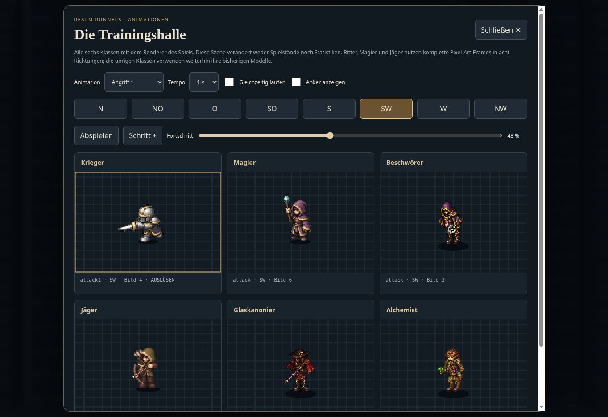

# Jäger – Bogenschuss 0.73.5

Veröffentlicht am 14.11.2026 über PR #68, Merge `761b456f1e1e1b69019aaabd03f7b4170b67703f`.

## Umsetzung

- 64 vollständige Schussbilder: acht Phasen in acht Richtungen.
- Freigegebene Standpose bleibt am Anfang und Ende pixelgenau erhalten.
- Pfeilabgabe bei halber Aktionsdauer; Ursprung je Richtung auf der gezeichneten Pfeilspitze vermessen.
- Normaler Schuss und Pfeilhagel verwenden dieselbe zur Figur passende Animation.
- Generierte Quellen und reproduzierbarer Packer liegen unter `assets/heroes/hunter/identity-attack-0735/` und `tools/pack-hunter-attack.cjs`.

## Prüfung

369 lokale Tests bestanden. GitHub-Prüflauf 43613896991 erfolgreich, einschließlich Chromium und WebKit. Die Browserprüfung deckt Menü, Trainingshalle, Dungeon, 72 Stand-/Laufzellen sowie 16 richtungsabhängige normale und spezielle Schussabgaben ab.

Zusätzlich im Browser alle acht voll gespannten Schussposen, Loslassen und Rückkehr zur Standpose visuell kontrolliert. Normalen Schuss, Pfeilhagel und Bewegung im Dungeon getestet. Öffentliche Version 0.73.5 nach erfolgreichem Pages-Deployment kontrolliert.

[Spiel](https://christian045.github.io/realm-runners/?v=0.73.5&debugAnimations=1)

Diese Version ergänzt den Bogenschuss. Treffer- und Todeszustände bleiben die vorhandenen einfachen Darstellungen; sie sind kein neu gezeichnetes vollständiges Animationsset.
