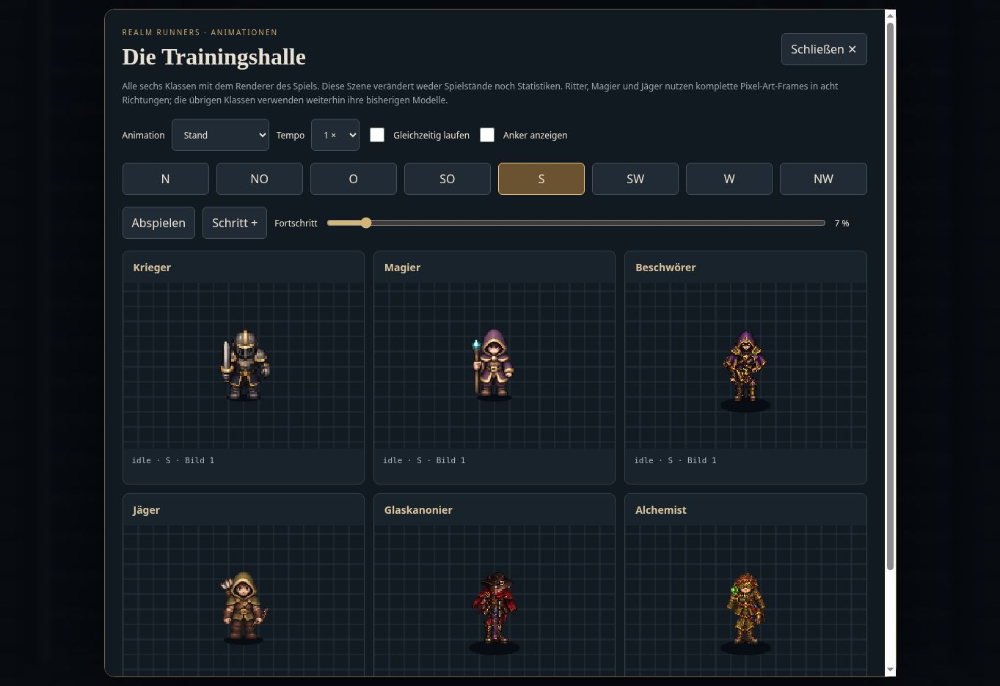

# Ritter – Materialangleichung 0.73.6

Die freigegebene Stilvorschau wurde als gemeinsame Materialpalette für alle zehn vorhandenen Ritteratlanten umgesetzt: 608 Zellen in acht Richtungen. Neutrale Stahlflächen erhalten warme Grautöne, dunklere Mitteltöne und gedämpfte Glanzlichter. Gold und blauer Stoff behalten ihre Materialfarben.

Die Original-PNGs bleiben erhalten. `src/knight-palette.js` bereitet die vollständigen Blätter einmal beim Laden auf; dieselben vorbereiteten Bilder werden in Menü, Trainingshalle und Dungeon verwendet. Es werden keine Gliedmaßen neu zusammengesetzt und keine Lauf- oder Angriffsbilder ersetzt.

## Validierung

- 370 Tests bestanden. Die zusätzliche Regression vergleicht den Alpha-Kanal aller zehn Blätter pixelgenau und prüft erhaltenes Gold sowie gedämpfte Metalllichter.
- Der vorhandene Rittertest kontrolliert weiterhin alle 608 Zellen, acht Richtungen, Bodenkontakt, Kombogrenzen und Klingen-Kontaktpunkte.
- Automatische Browserprüfung in Chromium und WebKit erfolgreich; Desktop- und Handybedienung enthalten.
- Stand, Lauf, Schlag und Finisher zusätzlich im Browser angesehen, normalen Angriff im Dungeon ausgeführt.
- Öffentliche Version nach erfolgreichem Pages-Deployment kontrolliert.

[Spiel](https://christian045.github.io/realm-runners/?v=0.73.6&debugAnimations=1)

